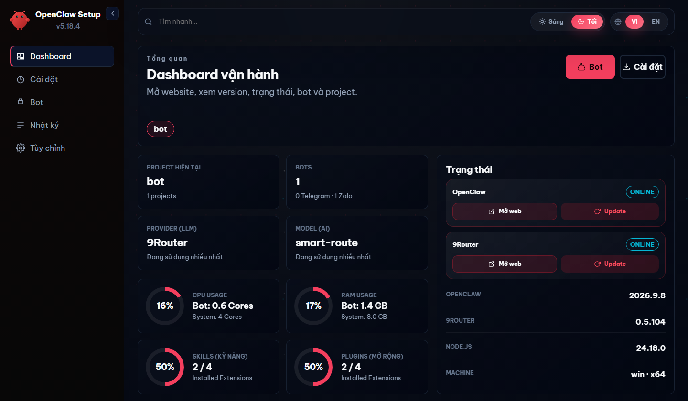
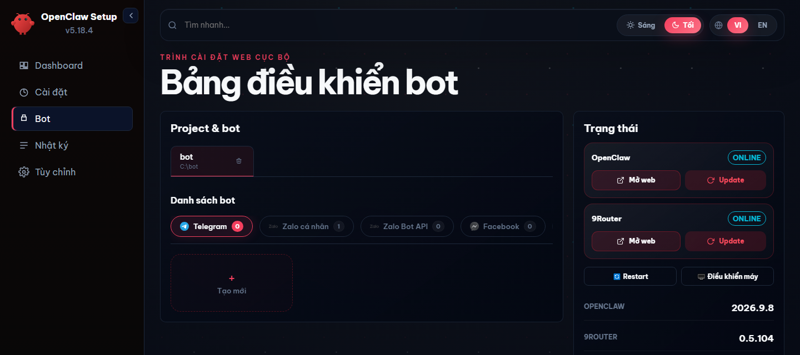

<div align="center">

# 🦞 OpenClaw Setup

**Install and run AI assistants on Zalo, Telegram and Messenger from a web dashboard. The bot runs directly on your machine, no terminal work needed.**

OpenClaw **2026.9.8** · Windows · macOS · Linux · MIT

[ Tiếng Việt](README.vi.md) ·  **English**



</div>

## Features

- **One dashboard for the whole bot lifecycle**: install OpenClaw and 9Router, create bots, log in to chat channels, edit the bot's persona, toggle skills and plugins, read the logs.
- **Multiple channels**: personal Zalo (QR login), Zalo Bot API, Telegram (one or many bots), Facebook Messenger (via plugin).
- **Many models through 9Router**: Gemini, Claude, GPT… sign in with your accounts instead of pasting API keys. The `smart-route` combo moves to another model when one runs out of quota.
- **Runs natively**, no Docker. A **Khởi động Bot** (Start Bot) shortcut is placed on the Desktop.
- **Your data stays on your machine**: config, keys and the bot's memory all live in the bot's folder.

## Requirements

- Windows 10/11, macOS or Linux.
- [Node.js 24 LTS](https://nodejs.org).
- [Git](https://git-scm.com/downloads), so `npx` can fetch the code from GitHub.
- On Windows, open PowerShell or Command Prompt **normally**; do **not** use "Run as administrator".

## Install

```bash
npx github:dangthanhhung61-dotcom/openclaw-setup-2026.9.8
```

The dashboard opens at **http://127.0.0.1:51789**. You choose the project folder there when you click **Install** (suggested: `C:\openclaw-setup` on Windows, `~/openclaw-setup` on macOS and Linux).

Or download the code and run it, no `npm install` needed:

```bash
git clone https://github.com/dangthanhhung61-dotcom/openclaw-setup-2026.9.8.git
node openclaw-setup-2026.9.8/dist/cli.js
```

## Steps in the dashboard

1. **Install**: pick the operating system and project folder, then click **Install**. Setup installs OpenClaw and 9Router and puts a shortcut on the Desktop. The first run takes a few minutes.
2. **Model accounts**: open 9Router at **http://127.0.0.1:20128** (default password `123456`), go to **Providers** and sign in to your model accounts. The `smart-route` combo is created automatically.
3. **Create a bot**: **Bot** tab → **Create bot**, choose the channel, then fill in the bot name, persona and owner name.
4. **Connect the channel**: for personal Zalo, scan the QR code with the Zalo app; for Telegram, paste the token from `@BotFather`.
5. **Send the bot a message**.



## Day to day

- **Start or stop the bot**: the **Khởi động Bot** shortcut on the Desktop, or the **Bot OpenClaw** folder in the Start Menu (which also has **Dừng Bot** and **Mở giao diện quản trị**, the dashboard).
- **Reopen the dashboard**: run the install command again, or use **Mở giao diện quản trị** in the Start Menu.
- **Edit the persona and rules**: **Bot** tab → file tree (`SOUL.md`, `AGENTS.md`, `USER.md`), then **Save**.
- **Update Setup**: when a new version is out, the dashboard shows an **Update x.y.z** button in the top bar. It installs the latest commit of this repository (not the npm package `create-openclaw-bot`, which is the upstream build). Running the `npx github:…` command again also gets the latest version.

## FAQ

<details>
<summary><b>The bot does not reply?</b></summary>

Check that 9Router has a model account and the `smart-route` combo (http://127.0.0.1:20128), then look at the **Logs** tab in the dashboard. After each start the bot needs about 1–2 minutes before it answers.
</details>

<details>
<summary><b>Can two bots share one Zalo account?</b></summary>

No. A Zalo account can run only one bot; a second bot logging in pushes the first one out.
</details>

<details>
<summary><b>Why not run it as Administrator?</b></summary>

The bot would run commands with full control of the machine, and skills that drive other apps (AutoCAD, for example) cannot connect to apps opened with normal rights.
</details>

<details>
<summary><b>Where is the bot's data?</b></summary>

In `C:\Users\<name>\.openclaw` (Windows) or `~/.openclaw` (macOS, Linux). The project's `.openclaw` folder is a link to it. Back up that folder and you keep the whole bot.
</details>

## More

- [Detailed guide: port table, Linux/VPS, remote dashboard access, troubleshooting](docs/SETUP.md)
- [Changelog](CHANGELOG.md)

## License

MIT. See [LICENSE](LICENSE).
